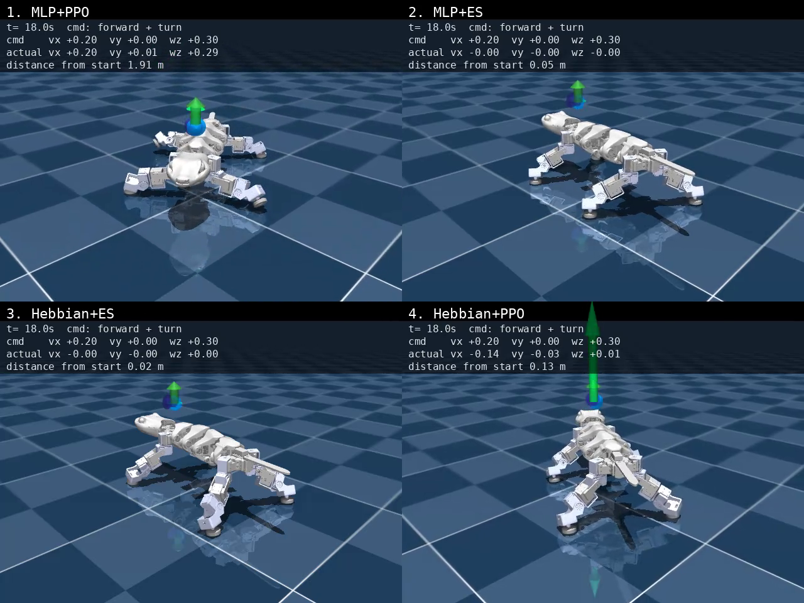
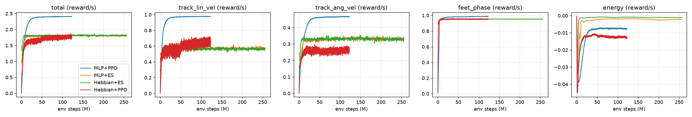

# Gecko locomotion: network × optimizer comparison

Results of training the same velocity-tracking task, `Gecko-Locomotion-Flat` (see
[LOCOMOTION.md](LOCOMOTION.md)), with two network types and two optimizers.
Evaluated 2026-10-13.

| # | Network | Optimizer | Checkpoint |
|---|---|---|---|
| 1 | MLP 512-256-128 (ELU) | PPO | `logs/rsl_rl/gecko_locomotion/2026-10-12_15-33-58/model_1499.pt` |
| 2 | MLP 128-64 (tanh) | OpenES | `logs/es/gecko_locomotion_es_ff/2026-10-12_18-08-15/es_499.pt` |
| 3 | Hebbian 128-64 (ABCD + learning rate) | OpenES | `logs/es/gecko_locomotion_es_hebb/2026-10-12_19-03-52/es_499.pt` |
| 4 | Hebbian 128-64 (ABCD + learning rate) | PPO | `logs/rsl_rl/gecko_locomotion_hebb_ppo/2026-10-12_20-45-23/model_5999.pt` |

## Bottom line

**Only MLP + PPO learned to walk.** It tracks every command to within 0.01 m/s and 0.03 rad/s,
never falls, and walked 1.75 m from its start point over the 27 s video sequence.

**The other three learned to stand still.** Their velocity is about 0 for every command,
and their return (1.75–1.82 reward/s) equals that of a policy that sends zero action
(1.79). With the current reward, standing still already earns 73% of the best return, and
these three never got past that. The [analysis](#why-cases-24-stand-still) explains why.

## Videos

All four robots run the same timed command sequence in the evaluation environment (no
pushes, no sensor noise, same seed), with a camera that follows the robot:

stand → forward 0.2 m/s → forward 0.3 m/s → turn left 0.4 rad/s → forward + turn → sideways 0.1 m/s → backward 0.1 m/s → stop (27 s)

Each tile shows the command, the measured whole-body velocity and the distance travelled.

- **Side by side (2×2):** [comparison/comparison.mp4](comparison/comparison.mp4)
- **Individual:** [mlp_ppo.mp4](comparison/mlp_ppo.mp4) ·
  [mlp_es.mp4](comparison/mlp_es.mp4) ·
  [hebbian_es.mp4](comparison/hebbian_es.mp4) ·
  [hebbian_ppo.mp4](comparison/hebbian_ppo.mp4)

<video src="comparison/comparison.mp4" controls width="100%"></video>



| Distance from start | 1 · MLP + PPO | 2 · MLP + ES | 3 · Hebbian + ES | 4 · Hebbian + PPO |
|---|---|---|---|---|
| after 6 s (forward 0.2 m/s) | 0.81 m | 0.05 m | 0.02 m | 0.01 m |
| after 13.5 s (turning) | 2.21 m | 0.05 m | 0.02 m | 0.09 m |
| end, 27 s | 1.75 m | 0.05 m | 0.02 m | 0.14 m |

Distance is the straight line from the start point, so MLP + PPO's figure drops after it
turns and walks back.

## Summary

Evaluated with deterministic actions (ES cases use the mean parameters `mu`) and 64 robots
per test:

- **Training-distribution test:** 20 s episodes with random commands, pushes, sensor noise
  and domain randomization (same as training).
- **Fixed-command tests:** 10 fixed commands in the evaluation environment, measured for 8 s
  after a 2 s warm-up.

| Case | Params | Env steps | Train time | Return/s ↑ | Fall rate | Velocity error (m/s) ↓ | Turn error (rad/s) ↓ | Power (W) | Joint-target rate (rad/s) |
|---|---|---|---|---|---|---|---|---|---|
| 1 · MLP + PPO | 224,550 | 123 M | 0.4 h | **2.449** | 0% | **0.004** | **0.010** | 5.54 | 0.95 |
| 2 · MLP + ES | 23,955 | 256 M | 0.9 h | 1.758 | 0% | 0.114 | 0.130 | 0.06 | 0.01 |
| 3 · Hebbian + ES | 118,720 | 256 M | 1.7 h | 1.753 | 0% | 0.114 | 0.130 | 0.01 | 0.00 |
| 4 · Hebbian + PPO | 118,739 | 123 M | 3.5 h | 1.824 | 0% | 0.114 | 0.131 | 0.78 | 0.13 |
| reference: zero action | 0 | – | – | 1.791 | 0% | 0.114 | 0.130 | 0 | 0 |

- **Return/s** is the task reward per second: the objective all four optimize. The maximum
  is about 2.5.
- **Errors** are averaged over the 10 fixed commands. 0.114 m/s and 0.130 rad/s are exactly
  the average command magnitudes, which is the error of a robot that doesn't move.
- **Joint-target rate** is how fast the commanded joint positions change. Near 0 means the
  policy holds a fixed pose.
- **Cost of transport** (power / (m·g·speed)) is only defined for MLP + PPO: 0.96 at
  0.3 m/s, 1.33 at 0.2 m/s and 1.99 at 0.1 m/s.

## Per command: achieved whole-body velocity (vx, vy, ωz)

| Command (vx, vy, ωz) | 1 · MLP + PPO | 2 · MLP + ES | 3 · Hebbian + ES | 4 · Hebbian + PPO |
|---|---|---|---|---|
| stand (0, 0, 0) | (0.00, 0.00, 0.00) | (0.00, 0.00, 0.00) | (0.00, 0.00, 0.00) | (0.00, 0.00, 0.00) |
| forward (0.1, 0, 0) | (0.09, 0.00, 0.01) | (0.00, 0.00, 0.00) | (0.00, 0.00, 0.00) | (0.00, 0.00, 0.00) |
| forward (0.2, 0, 0) | (0.20, 0.00, 0.02) | (0.00, 0.00, 0.00) | (0.00, 0.00, 0.00) | (0.00, 0.00, 0.00) |
| forward (0.3, 0, 0) | (0.30, 0.00, 0.01) | (0.00, 0.00, 0.00) | (0.00, 0.00, 0.00) | (0.00, 0.00, 0.00) |
| backward (−0.1, 0, 0) | (−0.10, 0.00, 0.00) | (0.00, 0.00, 0.00) | (0.00, 0.00, 0.00) | (0.00, 0.00, 0.00) |
| sideways (0, 0.1, 0) | (0.00, 0.09, 0.02) | (0.00, 0.00, 0.00) | (0.00, 0.00, 0.00) | (0.00, 0.00, 0.00) |
| turn left (0, 0, 0.4) | (0.00, 0.00, 0.40) | (0.00, 0.00, 0.00) | (0.00, 0.00, 0.00) | (0.00, 0.00, 0.00) |
| turn right (0, 0, −0.4) | (0.00, 0.00, −0.37) | (0.00, 0.00, 0.00) | (0.00, 0.00, 0.00) | (0.00, 0.00, 0.00) |
| walk + turn (0.2, 0, 0.3) | (0.20, 0.00, 0.30) | (0.00, 0.00, 0.00) | (0.00, 0.00, 0.00) | (0.00, 0.00, 0.00) |
| diagonal (0.1, 0.1, 0.2) | (0.10, 0.09, 0.20) | (0.00, 0.00, 0.00) | (0.00, 0.00, 0.00) | (0.00, 0.00, 0.00) |

No robot fell in any test.

MLP + PPO's swing feet reach 2.6–3.1 cm, matching the 3 cm reference. The other cases stay
at 0.3 cm, i.e. feet on the ground.

## Learning curves



Each panel shows per-term reward per second against environment steps.

- **MLP + PPO** climbs to 2.4 within about 25 M steps.
- **Cases 2–4** reach about 1.8 within the first ~10 M steps and stay flat. That plateau is
  the zero-action level (1.79), so they converged to standing almost immediately and never
  left.
- **Not directly comparable:** the ES curves are population averages, so they include
  exploration noise σ, and the PPO curves come from the stochastic policy. Use the tables
  above to compare final policies.

## Why cases 2–4 stand still

1. **Standing is a strong local optimum of this reward.** A robot that doesn't move earns
   73% of the best return:
   - The velocity-tracking kernel is wide, exp(−err²/0.05): standing against a 0.2 m/s
     command still gets 0.45 of 1.
   - The foot-phase reward is 0.94 with all feet down, because the swing reference is only
     3 cm high.

   Starting to step first *lowers* the reward. Only an optimizer that explores aggressively
   enough gets past the dip.
2. **The ES cases start at the standing policy.** The MLP's mean parameters start at 0,
   which is exactly zero action (the nominal standing pose). The Hebbian network starts from
   small random coefficients. Rank-based ES with σ = 0.1 then climbs toward the *best
   standing* policy: total reward rose from 1.5 (MLP) and 1.0 (Hebbian) to 1.8 by tuning posture.
3. **The Hebbian network saturates.** `var_norm` rescales every weight matrix to unit
   variance after each update. With 112 inputs, pre-activations are about √112 ≈ 10, so the
   tanh units sit at ±1, and the network can't produce small, graded joint commands. This
   affects both Hebbian cases; case 4 settles into a crouched, fixed pose.
4. **MLP + PPO escapes** because PPO's Gaussian action noise (initial std 1.0, around 0.5 rad
   of joint offset) makes the robot step from the very first iterations, so it finds
   rewarding gaits before it can lock into standing.

## What to try next

Each change below means re-training all four cases, one job at a time, about 7 h in total.

| Change | Fixes | Where |
|---|---|---|
| Narrow the tracking kernels: σ_v 0.05 → 0.01, σ_ω 0.1 → 0.02. Standing against a 0.2 m/s command then scores 0.02 instead of 0.45 | the standing optimum (all cases) | `locomotion_env_cfg.py`, rewards |
| Scale normalized Hebbian weights by 1/√fan_in | tanh saturation | `hebbian_neural_net.py` (and `hebbian_ppo.py`) |
| Larger σ_init (e.g. 0.3), or start ES from a random `mu` instead of 0 | ES starting at standing | `es_cfg.yaml`, `train_es.py` |
| Equal env-step budgets (ES: 240 generations ≈ 123 M steps) | fairness of the comparison | `es_cfg.yaml` `EPOCHS` |

## Setup notes

- **Same environment for every case:** same rewards, domain randomization, 112-dim actor
  observation, 50 Hz control and residual action with a 4 Hz low-pass filter. Details are in
  [LOCOMOTION.md](LOCOMOTION.md), sections 4 and 9.
- **Different budgets:** ES used 500 generations × 1024 robots × 500 steps (256 M steps). PPO
  used 123 M steps; case 4 ran with 1024 envs for 6000 iterations, because its stored
  Hebbian weights need about 2 GB of GPU memory.
- **Different network sizes:** case 1 is the tuned PPO MLP, while cases 2–4 use the sizes in
  `es_cfg.yaml`.
- **Hardware:** RTX 5060 Laptop GPU (8 GB). All runs were trained one at a time.

## Reproduce

```bash
# Train (one at a time)
uv run train Gecko-Locomotion-Flat --env.scene.num-envs 4096          # case 1
uv run python scripts/train_es.py --model ff                          # case 2
uv run python scripts/train_es.py --model hebb                        # case 3
uv run train Gecko-Locomotion-Flat-HebbPPO --env.scene.num-envs 1024  # case 4

# Evaluate and record (latest checkpoint of each case)
uv run python scripts/compare_policies.py   # → logs/compare/<date>/results.md, results.json, curves.png
uv run python scripts/record_videos.py      # → docs/comparison/*.mp4
```

Raw numbers: [comparison/results.json](comparison/results.json).
